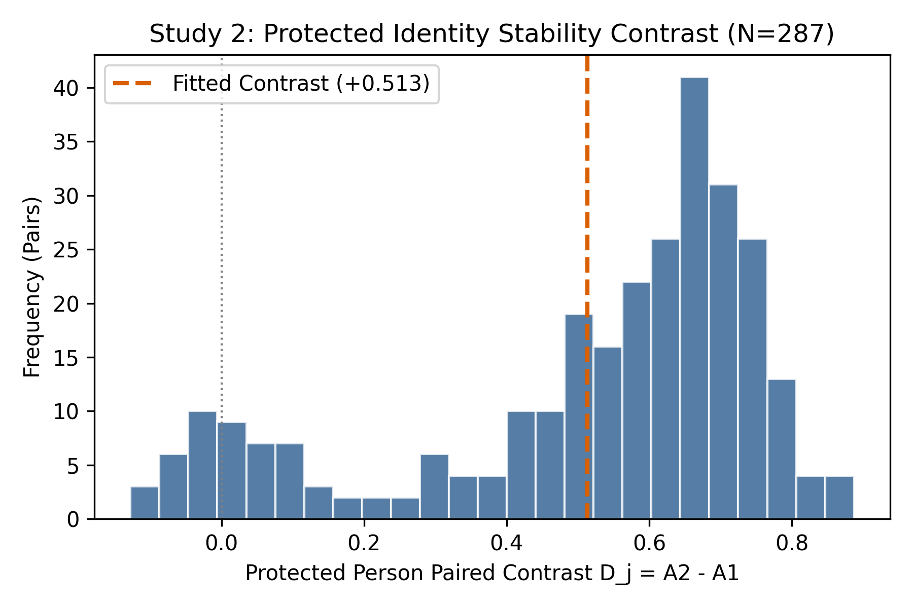
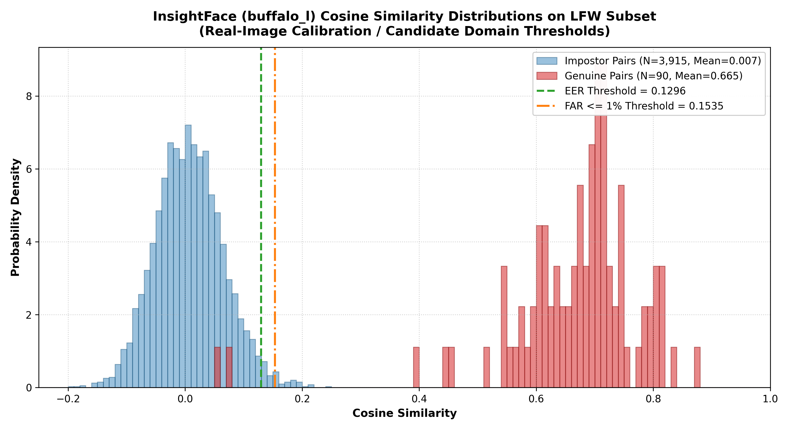
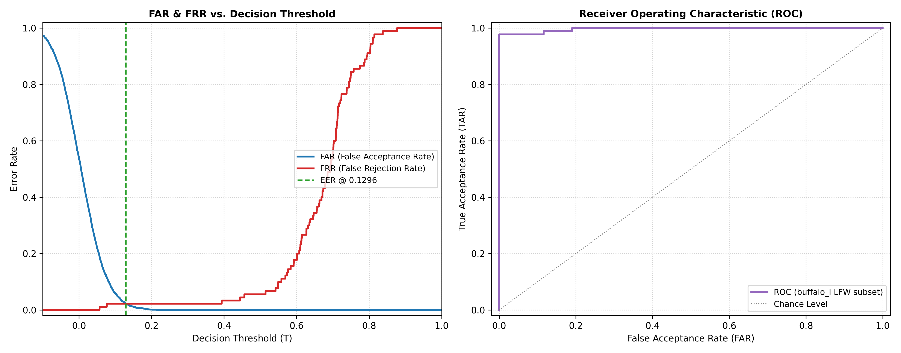

# Cross-Person Identity Change Under Source-Coupled Multi-Human Generation: A Controlled UniPortrait Study

**Paper A · Controlled Empirical Study · `Candidate_A_CONCISE_v1_1`**

[](#tier-1-quickstart)
[](environment/environment-analysis.yml)
[](#tier-1-quickstart)
[](LICENSE_STATUS.md)

> **Anonymous submission — double-blind peer review in progress.** Citation metadata will be finalized upon publication.

---

## Overview

We empirically characterize how **target and co-present protected identities change** under existing native [UniPortrait](https://github.com/junjiehe96/UniPortrait) conditioning regimes. Across **119 accepted two-person scenes** and three output seeds, this controlled study provides the first systematic quantification of cross-person identity change in source-coupled personalized multi-human generation.

**This study does not introduce a new generative model.** It evaluates three conditioning regimes already implemented in UniPortrait (A0, A1, A2) using continuous cosine-similarity transitions (ΔID) measured via InsightFace Buffalo_L.

**[📄 Paper]([docs](https://arxiv.org/pdf/2610.22746/)** &nbsp;|&nbsp; **[🌐 Project Website](https://edrees2022.github.io/face-identity-repair/)** &nbsp;|&nbsp; **[💻 Code](#tier-1-quickstart)**

---

## Key Findings

All values represent ΔID = Δcosine-similarity evaluated via **InsightFace Buffalo_L**. Bootstrap: 5,000 case-cluster percentile replicates, seed `20260921`.

| Study | Role | Contrast | N | Point Estimate | 95% CI | Replay |
|---|---|---|---|---|---|---|
| **Study 1** | Protected (j) | A1 − A0 | 597 (304+293) | **−0.557103** | [−0.582850, −0.530484] | `FROZEN VERIFIED` |
| **Study 1** | Target (k) | A1 − A0 | 597 (304+293) | **−0.215272** | [−0.245432, −0.184669] | `FROZEN VERIFIED` |
| **Study 2** | Protected (j) ⭐ | A2 − A1 | 287 paired rows | **+0.512918** | [+0.471434, +0.550259] | `REFIT TESTED` |
| **Study 2** | Target (k) | A2 − A1 | 287 paired rows | **+0.158853** | [+0.118903, +0.197523] | `REFIT TESTED` |
| **Study 2** | Supportive S3 | Full LMM | 623 obs. | **+0.498569** | [+0.458782, +0.538357] | `DOCUMENTED ONLY` |

> ⭐ **Primary estimand.** Positive D = ΔID(A2) − ΔID(A1) denotes *relative attenuation* of protected-identity degradation under dual-ID conditioning. It does not guarantee absolute facial preservation — A2 attenuates degradation in some cases but does not universally preserve identity.

---

## Conditioning Regimes

| Regime | Description | Role in Study |
|---|---|---|
| **A0** | No identity conditioning (unconditioned baseline) | Study 1 comparator |
| **A1** | Single-identity conditioning (target person only) | Study 1 treatment; Study 2 baseline |
| **A2** | Dual-identity conditioning (target + protected simultaneously) | Study 2 treatment |

Study 1 uses a cross-sectional design (A1 vs. A0). Study 2 uses a within-case paired design (A2 vs. A1) with matched output seeds.

---

## Study 1 — Key Observation

Under A1 conditioning: **90.46% of 304 realizations** fall in quadrant Q3 (both target k and protected j show negative ΔID). Zero realizations appear in Q2/Q4. This near-complete collapse of protected identity under target-only single-ID conditioning motivates the Study 2 dual-ID intervention.

---

## Figures

### Figure 1 — Study 2 Paired Contrasts



*Per-case ΔID(A2) − ΔID(A1) values for protected (j) and target (k) persons across 111 A2-measurable cases. Pearson r = 0.827 between paired protected/target ΔID values in A2. Dashed orange line marks fitted contrast = +0.513.*

### Figure 2 — Identity Calibration: Genuine vs. Impostor Distributions



*InsightFace (buffalo_l) cosine similarity distributions on LFW subset used for identity threshold calibration. Genuine pairs (N=90, Mean=0.665) and impostor pairs (N=3,915, Mean=0.007) show clean bimodal separation. EER threshold = 0.1296, FAR ≤ 1% threshold = 0.1535.*

### Figure 3 — FAR/FRR Curves and ROC



*Left: FAR (blue) and FRR (red) curves vs. decision threshold — EER at θ = 0.1296 (green dashed). Right: ROC curve on buffalo_l LFW subset — near-perfect separation confirming evaluator reliability for this benchmark domain.*

---

## Tri-Axis Validation

| Axis | Method | Protected Estimate | Target Estimate | Status |
|---|---|---|---|---|
| **V1** (Primary) | InsightFace Buffalo_L | +0.512918 [+0.471, +0.550] | +0.158853 [+0.119, +0.198] | 🔒 **PRIMARY ANCHOR** |
| **V1** (Independent) | ArcFace R100/MS1MV3 | +0.231351 [+0.207, +0.255] | +0.072272 [+0.048, +0.097] | ✅ CONCORDANT |
| **V3** (Locked Spec) | Cross-Cohort Replication | +0.477 [+0.437, +0.517] | +0.148 [+0.107, +0.188] | ✅ CONCORDANT |
| **V2** (Human) | Prospective Blinded Raters | — | — | ⏳ PENDING ETHICS AUTH |

---

## Tier 1 Quickstart

> **Requirements:** Python 3.9, CPU only. No GPU required for Tier 1 replay.

```bash
# Clone
git clone https://github.com/edrees2022/face-identity-repair.git
cd face-identity-repair

# Install pinned dependencies
pip install -r environment/requirements-analysis.txt

# Run full smoke test (all 14 tests + quick replay)
bash smoke_test.sh

# Tier 1a: Analysis replay with 1,000 bootstrap replicates (~28s)
python scripts/run_tier1a_analysis_replay.py --reps 1000

# Tier 1a: Full 5,000-replicate parity (~4m 42s) — exact CI parity to 6 decimals
python scripts/run_tier1a_analysis_replay.py --reps 5000

# Tier 1b: Cryptographic + numerical frozen verification
python scripts/run_tier1b_frozen_verification.py

# Data integrity check
python scripts/verify_data_integrity.py

# Full test suite
pytest tests/ -v
```

**Expected output (5,000 replicates):**
```
Protected 95% CI: [+0.471434, +0.550259]  SE: 0.020057
Target    95% CI: [+0.118903, +0.197523]  SE: 0.020346
==> EXACT NUMERICAL PARITY TO 6 DECIMALS
```

---

## Reproducibility Tiers

| Tier | Scope | Included | Executable |
|---|---|---|---|
| **1a** | LMM refit + bootstrap + Table S9 | ✅ | ✅ CPU (~5 min) |
| **1b** | Frozen output verification (crypto + numerical) | ✅ | ✅ CPU (~30s) |
| **2** | Full generative + embedding pipeline | Reference docs only | ❌ GPU + checkpoints required |

**Not included:** Source face portraits (SFHQ/FFHQ, user-acquired), biometric embeddings, UniPortrait checkpoints, private cohort manifest, or human-rater records. See [`data/README.md`](data/README.md) and [`environment/generation-instructions.md`](environment/generation-instructions.md).

---

## Repository Structure

```
face-identity-repair/
├── data/                          # Frozen numerical results & safe cohort manifest
│   ├── cohort_n119_safe_manifest.json   # Sanitized (no source filenames/prompts)
│   ├── study1_inference_summary.json    # Study 1 frozen LMM estimates
│   ├── study1_joint_summary.json        # Study 1 joint descriptives
│   ├── study2_joint_summary.json        # Study 2 joint descriptives
│   ├── study2_master_paired_input.csv   # Study 2 paired rows (N=287)
│   └── validation_summary.json          # V1/V3 validation axes
├── src/core/
│   ├── paired_lmm.py                    # Paired LMM implementation
│   └── cluster_bootstrap.py             # Case-cluster bootstrap
├── scripts/
│   ├── run_tier1a_analysis_replay.py    # Primary CPU replay script
│   ├── run_tier1b_frozen_verification.py # Frozen verification
│   ├── verify_data_integrity.py         # SHA256 integrity check
│   └── replay_figures.py                # Figure generation
├── tests/                         # 14 automated tests
├── configs/                       # Study protocol configurations
├── environment/                   # Requirements and generation docs
├── docs/                          # GitHub Pages website
│   ├── index.html
│   └── assets/
│       ├── fig_study2_paired_contrasts.png    # Figure 1: Study 2 paired contrasts
│       ├── genuine_impostor_distribution.png  # Figure 2: Identity calibration distributions
│       └── identity_threshold_curves.png      # Figure 3: FAR/FRR & ROC curves
├── smoke_test.sh                  # One-command verification
├── CITATION.cff                   # Citation metadata (pre-publication draft)
└── LICENSE_STATUS.md              # Licensing status
```

---

## Rights & Licensing

**License Status:** PENDING formal author and institutional clearance. This repository does not currently grant an active open-source license. See [`LICENSE_STATUS.md`](LICENSE_STATUS.md).

**Data Rights:**
- Frozen numerical summaries in `data/`: May be inspected for reproducibility verification
- Source face photographs: **Not included** — user must acquire SFHQ/FFHQ independently
- Biometric embeddings: **Not included** — private research artifacts
- Figures `fig_study2_paired_contrasts.png`, `genuine_impostor_distribution.png`, `identity_threshold_curves.png`: Non-identifying aggregate plots; no face images

**Upstream Dependencies:**
- [UniPortrait](https://github.com/junjiehe96/UniPortrait) (evaluated natively, no modifications)
- [InsightFace](https://github.com/deepinsight/insightface) Buffalo_L — non-commercial research use
- ArcFace R100/MS1MV3 — non-commercial research use

---

## Citation

> ⚠️ **Manuscript under double-blind review.** Do not cite as a published work.

```bibtex
@misc{candidateA2026,
  title  = {Cross-Person Identity Change Under Source-Coupled
            Multi-Human Generation: A Controlled UniPortrait Study},
  author = {Anonymous Authors},
  year   = {2026},
  note   = {Preprint — under review.
            Code: https://github.com/edrees2022/face-identity-repair}
}
```

---

## Acknowledgments

We thank the developers of UniPortrait, InsightFace, and ArcFace for releasing their implementations and enabling this evaluation. Benchmark datasets (SFHQ, FFHQ) were used under their respective terms for research purposes only.
